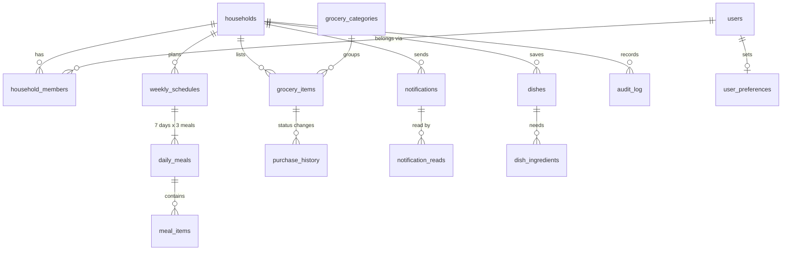

# HomeMeal: Weekly Meal Planner & Grocery Management

A React Native (Expo) app for Android and iOS, built to **HomeMeal SRS v1.0**. A homemaker (**Creator**) plans breakfast, lunch and dinner for the week and keeps the grocery list. Family members (**Viewers**) see the published menu and tick off groceries while shopping.

## Run it

```bash
npm install
npx expo start          # scan the QR code with Expo Go (Android / iOS)
npx expo start --web    # or run in a browser
```

Demo accounts (password `demo123`):

| Account | Role |
|---|---|
| anitha@homemeal.app | Creator (homemaker) |
| rahul@homemeal.app | Viewer (husband, main purchaser) |
| meera@homemeal.app | Viewer (daughter) |

**Registration.** Tap **Create account** on the login screen. Each new Creator household automatically gets a **household code** (shown in *Household members* with Share and New-code buttons). Family members join by tapping **Have a code?** and entering it. Personal one-person invites still work too.
- **Creator:** choose "I plan the family meals", fill in your details and a household name, then verify your mobile with an OTP. This creates a new, empty household with a "Get started" checklist.
- **Viewer:** choose "I'm joining my family" or tap **Have a code?**, then enter the invite code the Creator generated in *Household members*. The demo invite code is `AMMA42`, and the demo OTP is `1234`.

Each household's data is isolated (BR-011). Viewers can't register without a valid invite, so every Viewer belongs to a household (BR-002, FR-007).

On the web, open two tabs and sign in as the Creator in one and a Viewer in the other. Changes sync between the tabs live, which shows how the shared household works.

## What's covered from the SRS

| SRS area | Where |
|---|---|
| Sign-in, password recovery, role-based experience (FR-001–007) | `LoginScreen`, `store.js` (`login`, the `guardCreator` checks) |
| Registration: Creator creates a household, Viewer joins with an invite code, mobile OTP verification | `RegisterScreen`, `registerCreator` / `registerViewer` |
| Creator and Viewer dashboards (FR-008–010) | `HomeScreen` |
| 7-day planner, 3 meal slots, multiple dishes, all meal fields (FR-011–016, FR-021) | `PlannerScreen`, `MealEditorSheet` |
| Draft → Publish, "Updated" flag after edits (FR-017–020) | Planner bottom bar, `PreviewScreen` |
| Copy a meal to other days (FR-022) | `CopyMealSheet` |
| Future weeks, overlap prevention, history, copy a past week (FR-023–030, BR-012) | `CreateWeekSheet`, `WeeksScreen` |
| Grocery list: categories, units, priority, needed-by date, remarks, duplicate warning, search and filters (FR-031–039) | `GroceryScreen`, `GroceryEditorSheet` |
| Purchased, Partial, Cancelled and Revert, with audit trail (FR-040–047) | `ItemDetailSheet`, `setGroceryStatus` |
| Shared list, protection against conflicting updates (FR-048–053) | `version` check in `setGroceryStatus` |
| Notifications and preferences (FR-054–058) | `ActivityScreen`, `MoreScreen` |
| Household members: invite, deactivate (FR-006) | `MembersScreen` |
| Status shown by text + icon + colour (NFR-012), English/Malayalam (NFR-014) | `theme.js`, `i18n.js` |

## Live app vs. demo preview

- **The APK is the live app.** It starts empty, with no demo accounts. The first person registers as Creator and gets a clean household. Family members join with the household code.
- **The web preview is demo mode.** It's built with `EXPO_PUBLIC_DEMO_MODE=1`, which adds the sample "Menon Family", the demo logins and the pretend SMS step (code 1234).
- **Cleanup when updating:** phones that installed v1.0 or v1.1 have the sample family and its demo accounts removed automatically. Households people registered themselves are kept.
- **Not available in the live app yet:** SMS verification and password reset. Both need the online account service.

## Updates keep your data

- **Same signing key on every build.** The project pins it with `keystore/homemeal.keystore` and `plugins/withStableKeystore.js`, so a new APK always installs over the old one. Android only clears app data when you uninstall.
- **Upgrade, never reset.** On launch, saved data from any older version is upgraded in place: new columns are added (SQLite `ALTER TABLE`) and new fields such as the household code are filled in. Demo data is created only on the very first launch.
- **For a Play Store release,** switch to your own upload key, and keep it safe.

## Getting the Android APK

Building an APK needs the Android SDK, so use any one of these three options:

**A. GitHub (no setup on your computer).** Push this folder to a GitHub repository. Open the **Actions** tab, choose **Build Android APK**, then **Run workflow**. After about 15 minutes, download **HomeMeal-apk** from the run page. The workflow is `.github/workflows/android-apk.yml`.

**B. Expo cloud build (free Expo account).**
```bash
npm install
npx eas-cli@latest login
npx eas-cli@latest build -p android --profile preview
```
When it finishes, you get a download link and a QR code for the APK. The settings are in `eas.json`; the `preview` profile builds an APK.

**C. On your own PC (with Android Studio installed).**
```bash
npm install
npx expo prebuild --platform android
cd android && ./gradlew assembleRelease
# APK: android/app/build/outputs/apk/release/app-release.apk
```

To install the APK on a phone, copy it over and open it, allowing "Install unknown apps" when asked. For the Google Play Store, build an app bundle with `--profile production` and sign it with your own upload key.

## Online households (v1.3, Firebase)

Accounts and household data now live in Firebase (project `homemeal-c6116`), so a household code typed on **any phone** joins that family.

- **Sign-in:** Firebase Auth (email/password; a phone number is stored as `<phone>@phone.homemeal.app`).
- **Firestore layout:** `userHouseholds/{uid}` (which household an account belongs to), `joinCodes/{CODE}` (household + personal invite codes), `households/{hid}` and one sub-collection per table (`households/{hid}/grocery_items/{id}` …) — the same tables as the local database.
- **Sync:** every phone keeps its local SQLite copy and listens live to the household; only changed rows are sent. Works offline and catches up when back online.
- **Security rules:** `firebase/firestore.rules` (published). Only members can read a household; only the Creator edits menus, members and codes; Viewers can only update groceries/purchases/notifications and their own profile.
- **Moving old accounts online:** accounts created in v1.0–v1.2 move online automatically the first time they sign in on v1.3. The Creator should sign in first, then Viewers.
- **Limit (free Spark plan):** alerts arrive while the app is open or in recent apps. Push alerts when the app is fully closed need Cloud Messaging plus a small server (Blaze plan).
- The web preview stays a self-contained offline demo.

## Notifications & sound (v1.1)

- **New grocery items:** when the Creator adds items, Viewers hear the HomeMeal chime (`assets/sounds/grocery_chime.wav`). They also get a phone notification and an in-app banner showing the number of items still to buy, for example "🛒 Urgent: Green chillies needed · 1 kg · 11 items to buy now".
- **Badge count:** the app icon shows the number of pending items for Viewers, and unread updates for the Creator. The Grocery tab also shows the count.
- **Daily reminder:** while items are pending, a reminder plays at a chosen time (9 AM, 1 PM, 6 PM or 8 PM).
- **Settings:** under More → Notifications you can turn the sound or the reminder on or off and send a test notification.
- **Catch-up:** if alerts arrived while you were away, you get one summary with the chime the next time you open the app.
- **Android channels:** "Grocery alerts" (high priority, chime), "Shopping reminders", and "Silent updates" (used when sound is off). On Android 13 and later the app asks for notification permission on first launch.
- **Files:** `src/notify.js` (phone), `src/notify.web.js` (browser), `src/NotificationAgent.js` (decides what to alert).
- **Current limit:** each phone keeps its own data, so alerts reach someone signed in on the same phone or browser. To alert a Viewer's own phone when the Creator adds items on hers, add the shared server with Firebase Cloud Messaging (SRS §10). `NotificationAgent` already reacts to incoming data, so server push plugs into it.

## Database

Every record is saved as its own row in a table that matches the entities in SRS §7.1. The app does **not** save one big blob.

| Where | Storage |
|---|---|
| Android / iOS | A real **SQLite** database file (`homemeal.db`, via `expo-sqlite`), with foreign keys and indexes |
| Web preview | One browser-storage entry per row (`hm5:<table>:<id>`) |
| Server (production) | **PostgreSQL**: `database/schema.sql` is generated from the same definition |

When something changes, only the rows it touched are written. Ticking off one grocery item writes 3 rows: the item in `grocery_items`, one in `purchase_history` and one in `audit_log`. You can watch this live in **More → Data & storage**, which lists every table, its row count and the rows themselves.

**16 tables:** `households`, `users`, `household_members`, `user_preferences`, `weekly_schedules`, `daily_meals`, `meal_items`, `dishes`, `dish_ingredients`, `grocery_categories`, `grocery_items`, `purchase_history`, `notifications`, `notification_reads`, `audit_log`, `app_settings`.



- **Passwords** are stored only as salted SHA-256 hashes (`password_hash`, `password_salt`). On the server, use bcrypt or argon2 instead.
- **Concurrency:** each `grocery_items.version` goes up on every change, and an update based on an older version is rejected (FR-051).
- **Business rules in PostgreSQL:** 7-day weeks, no overlapping weeks (exclusion constraint), one active Creator per household, unique meal slots.
- **Files:** schema in `src/db/schema.js`, row mapping and diff in `src/db/mapper.js`, adapters in `src/db/adapter.js` (SQLite) and `src/db/adapter.web.js`.
- **Test** against real SQLite: `npm i -D sql.js esbuild && npx esbuild scripts/db-test.mjs --bundle --platform=node --format=esm --external:sql.js --outfile=/tmp/t.mjs && node /tmp/t.mjs`

## Motion

- An animated splash screen.
- A tab indicator that springs between tabs, icons that bounce, and badges that pop when the count goes up.
- Screens fade and slide in. Opening a screen slides it in with depth, and lists and cards stagger in.
- Ticking an item fills the check with a ripple, then the row slides away into "Purchased".
- Numbers count up, progress bars fill, and the notification bell wiggles when something new arrives.
- In the planner, the day's meals slide in from the direction you swiped.
- A burst of Kerala-themed confetti plays when you publish a week, finish shopping or sign up.
- Bottom sheets open with a spring and toasts slide up with Undo.
- All motion respects the phone's "Reduce motion" setting.

## UX additions beyond the SRS

- **Build the grocery list from the menu.** Each saved dish knows its ingredients. Adding a dish, or tapping "Build grocery list" on a week, adds what's needed. Matching items already on the list are merged, not duplicated.
- **Quick-pick dish library.** Kerala staples are built in and your own dishes are remembered, so planning a week takes a few taps.
- **Shopping mode.** A full-screen list for use in the shop, with large tap targets and a progress counter. Long-press an item to record a partial purchase.
- **Undo instead of "Are you sure?".** Ticking an item is one tap with a 5-second Undo, as SRS §9.2 asks. Reverting a purchase still asks for confirmation (FR-044).
- **Share to WhatsApp.** Send the list or the week's menu as formatted text.
- **Special-instruction chips** such as "Less spicy", "No onion" and "Pack for lunchbox".
- **"Next meal" hero** for Viewers. The meal coming up is highlighted.
- **Swipe between days**, auto-saved drafts, haptic feedback, and empty states that tell you what to do next.

## Structure

```
App.js                 fonts, providers, tabs
src/store.js           business rules + state (swap actions for REST API)
src/db/                schema, row mapper, SQLite + web adapters, hashing
src/motion.js          animation components
database/schema.sql    PostgreSQL schema for the backend
src/seed.js            demo household + dish library
src/nav.js             tab + stack navigation (no native deps)
src/ui.js              design-system components (Button, Sheet, Chip, Toast…)
src/sheets.js          bottom sheets (meal, grocery, week, item detail)
src/screens/*          screens
src/theme.js           colours, type, meal & status tokens
src/i18n.js            English + Malayalam
src/fonts.web.js       fonts embedded for web (generated)
```

## Going to production

`store.js` contains every business rule in one place. Each action (`publishSchedule`, `setGroceryStatus`, and the rest) maps one-to-one to an endpoint of the Node.js/.NET + PostgreSQL backend suggested in SRS §10. The backend must repeat the role checks (NFR-007) and the `version` concurrency check (FR-051). Live sync then comes from WebSockets or push notifications instead of the browser-tab sync used here. Build store binaries with `npx eas-cli build`.
